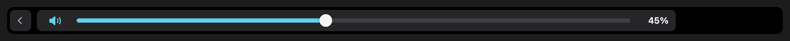
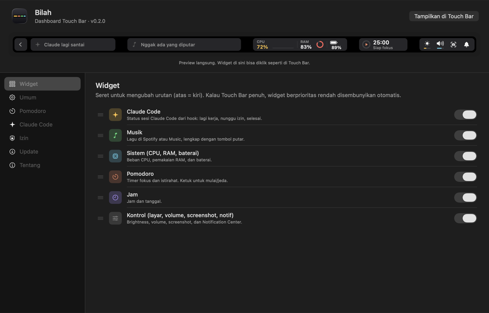

# Bilah

Dashboard Touch Bar untuk MacBook Pro. Tampil di semua aplikasi, bukan cuma saat app-nya aktif.


| Widget | Isi | Ketuk |
|---|---|---|
| Claude Code | Status tiap sesi: lagi kerja, nunggu izin (kapsul berdenyut kuning), selesai | Pindah ke sesi berikutnya |
| Musik | Spotify / Music: judul, artis, equalizer, cincin progres | Tombol ⏮ ⏯ ⏭; ketuk judul untuk membuka player |
| Sistem | CPU + grafik 36 detik, RAM, baterai | – |
| Pomodoro | Fokus → istirahat otomatis | Mulai / jeda / lanjut; ↺ untuk reset saat dijeda |
| Jam | Jam dan tanggal | – |
| Pintasan cepat | Tombol favorit yang kamu pin (default: kecerahan, volume, screenshot, notifikasi) | Jalankan pintasan; ⊞ membuka panel semua pintasan |

## Pintasan

Tombol ⊞ di widget Pintasan cepat membuka panel selebar Touch Bar berisi semua tombol bawaan Mac, mirip Expanded Control Strip. Kalau tidak muat, geser panelnya.


| Grup | Tombol |
|---|---|
| Layar | Kecerahan (slider), lampu keyboard (slider), Night Shift, mode gelap |
| Suara & media | Volume (slider), bisu, lagu sebelumnya, putar/jeda, lagu berikutnya |
| Jendela | Mission Control, App Exposé, tampilkan desktop, Apps (Launchpad) |
| Sistem | Spotlight, Siri, screenshot, Notification Center, Control Center (Focus, Wi-Fi), kunci layar, sleep, screen saver, ganti bahasa keyboard |
| Ekstra | Emoji & simbol, Kafein (Mac tetap melek) |
| Tambahan kamu | Aplikasi apa pun dan Shortcuts dari app Shortcuts |

Tombol yang punya status (Night Shift, mode gelap, bisu, Kafein) menyala saat aktif. Kecerahan, lampu keyboard, dan volume membuka slider:



Semua diatur di jendela Bilah › **Pintasan**: nyalakan/matikan, urutkan, pin maksimal 6 tombol ke Pintasan cepat, dan tambah aplikasi atau Shortcut.

Tombol `‹` di kiri mengecilkan dashboard. Ikon Bilah di Control Strip memunculkannya lagi, lengkap dengan titik status Claude.

## Pasang

1. Unduh `Bilah.zip` dari [Releases](https://github.com/sanadunt/bilah/releases/latest), ekstrak, lalu pindahkan `Bilah.app` ke folder Applications.
2. Buka Bilah. Karena app ini tidak dinotarisasi Apple, macOS akan menahannya saat pertama dibuka. Buka System Settings › Privacy & Security, lalu klik **Open Anyway** di bagian bawah. Ini cukup sekali.
3. Pastikan System Settings › Keyboard › Touch Bar Settings › "Touch Bar shows" diset ke **App Controls**.

## Mengatur

Membuka Bilah (dari Launchpad, Finder, atau menu bar › **Buka Bilah…**) menampilkan jendela utama:



- **Preview langsung** di atas: Touch Bar tiruan dengan data asli, dan widgetnya bisa diklik.
- **Widget**: seret untuk mengubah urutan, nyalakan atau matikan tiap widget.
- **Pintasan**: pilih tombol, pin favorit, tambah aplikasi dan Shortcuts.
- **Umum**: lebar penuh atau dengan Control Strip, buka otomatis saat login.
- **Pomodoro**: durasi fokus dan istirahat.
- **Claude Code**: pasang hook dengan satu klik dan lihat sesi yang sedang berjalan.
- **Izin**: status izin macOS dan tombol untuk memintanya.
- **Update**: cek dan pasang versi baru.

Selama jendela terbuka, Bilah muncul di Dock. Begitu ditutup, Bilah kembali ke menu bar dan Touch Bar saja. Kalau dibuka otomatis saat login, jendelanya tidak muncul.

## Update

Bilah mengecek [rilis GitHub](https://github.com/sanadunt/bilah/releases) saat dibuka dan setiap 6 jam. Kalau ada versi baru, tombol **Update vX tersedia** muncul di jendela dan di menu bar. Satu klik akan mengunduh, memverifikasi, memasang, lalu membuka ulang Bilah.

Updater hanya menerima app yang ditandatangani dengan sertifikat yang sama dengan versi yang sedang terpasang. Zip yang dimodifikasi atau palsu ditolak.

## Claude Code

Di jendela Bilah › **Claude Code**, klik **Pasang** di samping `settings.json` yang dipakai Claude Code kamu. Bilah hanya menambahkan entri hook-nya sendiri, dan versi lama file itu dicadangkan sebagai `settings.json.bilah-backup`. Sesi Claude yang sudah berjalan perlu dibuka ulang.

Hook-nya hanya menulis file kecil di `~/Library/Application Support/Bilah/claude/` (sekitar 8 ms per panggilan), selalu keluar dengan kode 0, dan tidak pernah memblokir tool.

## Izin

- **Automation (Spotify/Music)**: ditanyakan saat widget Musik pertama kali membaca lagu.
- **Aksesibilitas**: untuk tombol media, Spotlight, emoji, Notification Center, dan Control Center. Bilah mengirim tombol keyboard/media atau "mengklik" menu bar lewat Accessibility API.

Karena tiap rilis ditandatangani sertifikat yang sama, izin yang sudah diberikan tetap ada setelah update.

## Batasan

- Memakai API Touch Bar privat (DFRFoundation), cara yang sama dengan Pock dan MTMR. Sudah dicek ada di macOS 26.5.2, tapi bisa hilang di versi berikutnya. Kalau hilang, Bilah menampilkan peringatan.
- Brightness memakai `DisplayServices`, lampu keyboard dan Night Shift memakai `CoreBrightness`, mode gelap memakai `SkyLight`, dan Mission Control/App Exposé/desktop memakai notifikasi Dock. Semuanya privat. Yang diatur hanya layar bawaan MacBook.
- Dikte tidak disertakan karena tidak ada cara andal untuk memicunya dari luar.
- Widget Musik memakai AppleScript karena MediaRemote sudah dikunci Apple sejak macOS 15.4. Spotify/Music tidak pernah dibuka paksa.
- Kalau bar tidak muat, widget berprioritas rendah disembunyikan duluan: Jam dulu, lalu Musik/Sistem/Kontrol.

## Pengembangan

Cukup Command Line Tools, tidak perlu Xcode.

```bash
./scripts/build-app.sh
```

Perintah di atas mem-build `build/Bilah.app` dengan versi dari file `VERSION`. Kalau sertifikat "Bilah Local Signing" ada di keychain, app ditandatangani dengan sertifikat itu; kalau tidak, ad-hoc.

```bash
./scripts/release.sh 0.3.0
```

Perintah di atas merilis versi baru: menaikkan `VERSION`, build, membuat zip, commit + tag, push, lalu membuat GitHub Release dengan `Bilah.zip`. Rilis ditolak kalau build-nya ad-hoc, karena updater di app yang terpasang tidak akan menerimanya. Tambahkan path file markdown sebagai argumen kedua untuk catatan rilis sendiri.

Perintah bantu (jalankan dari `build/Bilah.app/Contents/MacOS/Bilah`):

| Perintah | Fungsi |
|---|---|
| `snapshot docs/preview.png` | Render bar dan slider ke PNG tanpa menyentuh Touch Bar |
| `snapshot-window out.png [halaman]` | Render jendela utama ke PNG tanpa menampilkannya |
| `hook-config` | Cetak konfigurasi hook Claude Code |

```
Sources/Bilah/
  main.swift                    mode app / hook / snapshot
  App/                          AppDelegate (menu, jendela, login), Snapshot
  TouchBar/PrivateTouchBar      jembatan API privat (aman kalau simbol hilang)
  TouchBar/DashboardController  bangun bar, slider, tick tiap detik, ikon Control Strip
  UI/                           Theme, Draw, WidgetView, Animator 30 fps, BarPreview (layout + preview)
  Widgets/                      satu file per widget (model + view)
  Claude/ClaudeStore            status sesi, mode hook, pasang/copot hook
  System/SystemControls         volume, brightness, screenshot, menu bar (Notification/Control Center)
  System/ShortcutActions        daftar tombol bawaan, status, dan eksekutor tiap aksi
  System/Updater                cek, unduh, verifikasi, pasang update dari GitHub
  Settings/                     SettingsStore (UserDefaults) + jendela utama SwiftUI
```

Menambah widget: buat kelas yang memenuhi `Widget` (`makeView()` dan `tick()`), turunkan view-nya dari `WidgetView`, lalu daftarkan di `WidgetKind` dan `DashboardController.widgets`. Preview di jendela otomatis ikut.
