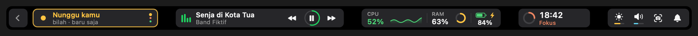
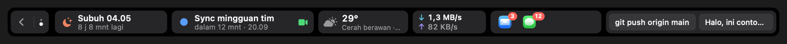
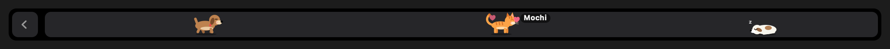
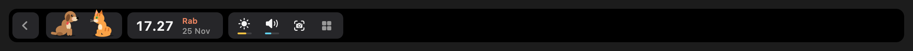
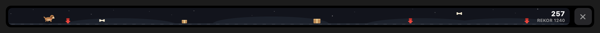
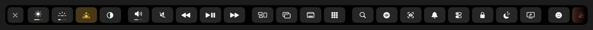
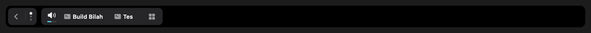
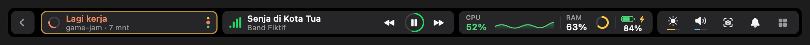
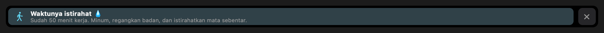

# Bilah

Dashboard Touch Bar untuk MacBook Pro. Tampil di semua aplikasi, bukan cuma saat app-nya aktif.



| Widget | Isi | Ketuk |
|---|---|---|
| Claude Code | Status tiap sesi: lagi kerja, nunggu izin (kapsul berdenyut kuning), selesai | Pindah ke sesi berikutnya |
| Musik | Lagu dari aplikasi apa pun di Now Playing macOS (Spotify, Music, YouTube di browser, VLC, TIDAL, dll): judul, artis, equalizer, cincin progres | Tombol ⏮ ⏯ ⏭; ketuk judul untuk membuka aplikasinya; kalau belum ada yang diputar, ▶ membuka aplikasi musik pilihanmu |
| Sistem | CPU + grafik 36 detik, RAM, baterai | – |
| Pomodoro | Fokus → istirahat otomatis | Mulai / jeda / lanjut; ↺ untuk reset saat dijeda |
| Jam | Jam dan tanggal | – |
| Peliharaan | Anjing dan kucing animasi: jalan, lari, duduk, tidur, joget saat musik diputar, kadang kejar-kejaran | Ketuk peliharaan untuk mengelus (❤ + namanya muncul); ketuk tempat kosong untuk memanggilnya |
| Pintasan cepat | Tombol favorit yang kamu pin (default: kecerahan, volume, screenshot, notifikasi) | Jalankan pintasan; ⊞ membuka panel semua pintasan |

## Halaman Info



| Widget | Isi |
|---|---|
| Jadwal sholat | Waktu sholat berikutnya + hitung mundur; berdenyut saat waktunya masuk. Dihitung offline (parameter Kemenag RI) untuk kota pilihanmu. |
| Rapat berikutnya | Acara berikutnya dari Kalender macOS. Ketuk untuk langsung membuka link Meet/Zoom/Teams. |
| Cuaca | Suhu dan cuaca sekarang (Open-Meteo, tanpa akun). |
| Kecepatan internet | Unduh dan unggah saat ini. |
| Badge aplikasi | Aplikasi dengan notifikasi belum dibaca (badge di Dock); ketuk untuk membukanya. |
| Riwayat clipboard | Teks yang baru disalin; ketuk untuk menempelkannya lagi. Hanya di memori, dan isi dari pengelola sandi tidak dicatat. |

Lokasi diatur di jendela Bilah › **Info & Lokasi**.

## Peliharaan



Sampai 3 peliharaan, masing-masing anjing atau kucing dengan 4 pilihan warna dan nama sendiri (jendela Bilah › **Peliharaan**). Mereka jalan-jalan sendiri, tidur kalau lama tidak disapa atau sudah malam, dan joget kalau ada musik diputar. Area mainnya ikut lebar widget, jadi makin lebar di Atur tata letak, makin luas tempat mainnya.

Mau hemat tempat? Pilih **Kotak kecil** di halaman Peliharaan: ±40 pt per peliharaan, mereka duduk berhadapan, tidur, dan joget di tempat tanpa jalan-jalan.



## Game: Kejar Camilan



Peliharaan pertamamu lari di Touch Bar. **Ketuk di mana saja untuk lompat** (ketuk sebentar = lompat pendek, ketuk lagi di udara = lompat ganda yang melayang). Lompati kardus, hidran, dan bola. **Jangan lompat saat burung lewat**, karena burung terbang tepat setinggi lompatanmu. Kumpulkan camilan (tulang untuk anjing, ikan untuk kucing, masing-masing +10). Makin jauh makin cepat, dan rekor tertinggi disimpan.

Buka lewat tombol 🎮 di panel Pintasan (bisa di-pin), menu bar › **Main Kejar Camilan di Touch Bar**, atau jendela Bilah › **Peliharaan**. Tutup dengan ×.

## Pintasan

Tombol ⊞ di widget Pintasan cepat membuka panel selebar Touch Bar berisi semua tombol bawaan Mac, mirip Expanded Control Strip. Kalau tidak muat, geser panelnya.



| Grup | Tombol |
|---|---|
| Layar | Kecerahan (slider), lampu keyboard (slider), Night Shift, mode gelap |
| Suara & media | Volume (slider), bisu, lagu sebelumnya, putar/jeda, lagu berikutnya |
| Jendela | Mission Control, App Exposé, tampilkan desktop, Apps (Launchpad) |
| Sistem | Spotlight, Siri, screenshot, Notification Center, Control Center (Focus, Wi-Fi), kunci layar, sleep, screen saver, ganti bahasa keyboard |
| Ekstra | Emoji & simbol, Kafein (Mac tetap melek), Game: Kejar Camilan |
| Tambahan kamu | Aplikasi apa pun, Shortcuts dari app Shortcuts, dan **tombol perintah** (perintah shell milikmu) |

Tombol yang punya status (Night Shift, mode gelap, bisu, Kafein) menyala saat aktif. Kecerahan, lampu keyboard, dan volume membuka slider dengan urutan **slider | − | + | ×**: geser jalurnya, ketuk −/+ untuk naik-turun 1/16 (tahan = berulang), × untuk menutup.


Semua diatur di jendela Bilah › **Pintasan**: nyalakan/matikan, urutkan, pin maksimal 6 tombol ke Pintasan cepat, dan tambah aplikasi, Shortcut, atau perintah.

**Tombol perintah** menjalankan perintah shell (zsh) di folder pilihanmu, mis. `./scripts/build-app.sh` atau `swift test`. Tombolnya menampilkan ⏳ saat berjalan lalu ✓/✗; output-nya dicatat di `~/Library/Logs/Bilah/perintah.log`. Gabungkan dengan profil per aplikasi supaya tombol build muncul sendiri saat Godot/Xcode aktif.



Tombol `‹` di kiri mengecilkan dashboard. Ikon Bilah di Control Strip memunculkannya lagi, lengkap dengan titik status Claude.

## Pasang

1. Unduh `Bilah.zip` dari [Releases](https://github.com/sanadunt/bilah/releases/latest), ekstrak, lalu pindahkan `Bilah.app` ke folder Applications.
2. Buka Bilah. Karena app ini tidak dinotarisasi Apple, macOS akan menahannya saat pertama dibuka. Buka System Settings › Privacy & Security, lalu klik **Open Anyway** di bagian bawah. Ini cukup sekali.
3. Pastikan System Settings › Keyboard › Touch Bar Settings › "Touch Bar shows" diset ke **App Controls**.

## Mengatur

Buka Bilah (Launchpad, Finder, atau menu bar › **Buka Bilah…**) untuk membuka jendela pengaturan bergaya System Settings. Jendelanya bisa diubah ukurannya, dan sidebar-nya dikelompokkan:

| Kelompok | Halaman |
|---|---|
| Touch Bar | **Tata letak**: preview langsung (bisa diklik dan digeser), Atur tata letak, widget per halaman, halaman, dan profil per aplikasi · **Pintasan** |
| Widget | **Musik** · **Peliharaan & Game** · **Info & Lokasi** · **Fokus** (Pomodoro + pengingat istirahat) · **Claude Code** |
| Aplikasi | **Tampilan** (tema, perilaku Touch Bar, login) · **Izin** · **Update** · **Tentang** |

Tombol **Tampilkan/Sembunyikan di Touch Bar** dan pemberitahuan update ada di toolbar. Selama jendela terbuka, Bilah muncul di Dock; begitu ditutup, Bilah kembali ke menu bar dan Touch Bar saja. Kalau dibuka otomatis saat login, jendelanya tidak muncul.

**Atur tata letak** (di halaman Tata letak): seret widget untuk memindah, tarik garis di tepi kanan untuk mengecilkan/membesarkan (ukuran pt tampil di bawah tiap widget), klik dua kali untuk ukuran bawaan, × untuk menyembunyikan. Meteran menunjukkan berapa pt yang terpakai dari lebar Touch Bar, dan sisa ruang dipakai sesuai pilihan jarak: **Isi penuh** (bawaan: lebar yang kamu atur jadi ukuran dasar, lalu widget melebar sebanding mengisi Touch Bar), **Sebar merata**, atau **Rapat**.



## Update

Bilah mengecek [rilis GitHub](https://github.com/sanadunt/bilah/releases) saat dibuka dan setiap 6 jam. Kalau ada versi baru, tombol **Update vX tersedia** muncul di jendela dan di menu bar. Satu klik akan mengunduh, memverifikasi, memasang, lalu membuka ulang Bilah.

Updater hanya menerima app yang ditandatangani dengan sertifikat yang sama dengan versi yang sedang terpasang. Zip yang dimodifikasi atau palsu ditolak.

## Claude Code

Di jendela Bilah › **Claude Code**, klik **Pasang** di samping `settings.json` yang dipakai Claude Code kamu. Bilah hanya menambahkan entri hook-nya sendiri, dan versi lama file itu dicadangkan sebagai `settings.json.bilah-backup`. Sesi Claude yang sudah berjalan perlu dibuka ulang.

Hook-nya hanya menulis file kecil di `~/Library/Application Support/Bilah/claude/` (sekitar 8 ms per panggilan), selalu keluar dengan kode 0, dan tidak pernah memblokir tool.

- Saat Claude bekerja, baris kedua widget menunjukkan tool yang sedang dipakai, mis. "bilah · Edit · Widget.swift".
- Ketuk sesi untuk membuka aplikasi tempat sesi itu berjalan (Terminal, iTerm, VS Code, atau app Claude). Titik-titik di kanan = pindah sesi.
- Peliharaan lompat senang setiap Claude selesai bekerja.

## Pengingat istirahat

Setelah 50 menit kerja tanpa jeda (bisa diatur di Umum), Touch Bar mengingatkan untuk istirahat dan peliharaan ikut menyapa. Diam 5 menit dihitung sudah istirahat.



## Izin

- **Automation (Spotify/Music)**: ditanyakan saat widget Musik pertama kali membaca lagu.
- **Aksesibilitas**: untuk tombol media, Spotlight, emoji, Notification Center, dan Control Center. Bilah mengirim tombol keyboard/media atau "mengklik" menu bar lewat Accessibility API.

Karena tiap rilis ditandatangani sertifikat yang sama, izin yang sudah diberikan tetap ada setelah update.

## Batasan

- Memakai API Touch Bar privat (DFRFoundation), cara yang sama dengan Pock dan MTMR. Sudah dicek ada di macOS 26.5.2, tapi bisa hilang di versi berikutnya. Kalau hilang, Bilah menampilkan peringatan.
- Brightness memakai `DisplayServices`, lampu keyboard dan Night Shift memakai `CoreBrightness`, mode gelap memakai `SkyLight`, dan Mission Control/App Exposé/desktop memakai notifikasi Dock. Semuanya privat. Yang diatur hanya layar bawaan MacBook.
- Dikte tidak disertakan karena tidak ada cara andal untuk memicunya dari luar.
- Sejak macOS 15.4, MediaRemote (sumber Now Playing) hanya melayani proses milik Apple. Bilah memuat helper kecil (`Helpers/MediaRemoteBridge.m`) lewat `/usr/bin/perl` supaya tetap bisa membaca semua aplikasi. Kalau cara ini suatu saat diblokir, Bilah otomatis kembali ke AppleScript (hanya Spotify dan Music). Aplikasi musik tidak pernah dibuka tanpa kamu ketuk.
- Kalau widget tidak muat, Claude dan Musik menyusut dulu; kalau masih tidak muat, dashboard bisa digeser ke kiri/kanan. Tidak ada widget yang disembunyikan.

## Pengembangan

Cukup Command Line Tools, tidak perlu Xcode.

```bash
./scripts/build-app.sh
```

Perintah di atas mem-build `build/Bilah.app` dengan versi dari file `VERSION`. Kalau sertifikat "Bilah Local Signing" ada di keychain, app ditandatangani dengan sertifikat itu; kalau tidak, ad-hoc.

```bash
./scripts/release.sh 0.3.0
```

Perintah di atas merilis versi baru: menaikkan `VERSION`, build, membuat zip, commit + tag, push, lalu membuat GitHub Release dengan `Bilah.zip`. Rilis ditolak kalau build-nya ad-hoc, karena updater di app yang terpasang tidak akan menerimanya. Tambahkan path file markdown sebagai argumen kedua untuk catatan rilis sendiri.

Perintah bantu (jalankan dari `build/Bilah.app/Contents/MacOS/Bilah`):

| Perintah | Fungsi |
|---|---|
| `snapshot docs/preview.png` | Render bar dan slider ke PNG tanpa menyentuh Touch Bar |
| `snapshot-window out.png [halaman]` | Render jendela utama ke PNG tanpa menampilkannya |
| `hook-config` | Cetak konfigurasi hook Claude Code |
| `music-status` | Tampilkan lagu yang terbaca dan jalurnya (universal atau cadangan) |

```
Sources/Bilah/
  main.swift                    mode app / hook / snapshot
  App/                          AppDelegate (menu, jendela, login), Snapshot
  TouchBar/PrivateTouchBar      jembatan API privat (aman kalau simbol hilang)
  TouchBar/DashboardController  bangun bar, slider, tick tiap detik, ikon Control Strip
  UI/                           Theme, Draw, WidgetView, Animator 30 fps, BarPreview (layout + preview)
  Widgets/                      satu file per widget (model + view)
  Claude/ClaudeStore            status sesi, mode hook, pasang/copot hook
  System/SystemControls         volume, brightness, screenshot, menu bar (Notification/Control Center)
  System/ShortcutActions        daftar tombol bawaan, status, dan eksekutor tiap aksi
  System/Updater                cek, unduh, verifikasi, pasang update dari GitHub
  Game/                         Kejar Camilan: mesin game (logika murni) + tampilan Touch Bar
  System/MusicMonitor           Now Playing semua aplikasi (MediaRemote lewat perl) + cadangan AppleScript
Helpers/MediaRemoteBridge.m     helper Objective-C yang dimuat /usr/bin/perl
  Settings/                     SettingsStore (UserDefaults) + jendela utama SwiftUI
```

Menambah widget: buat kelas yang memenuhi `Widget` (`makeView()` dan `tick()`), turunkan view-nya dari `WidgetView`, lalu daftarkan di `WidgetKind` dan `DashboardController.widgets`. Preview di jendela otomatis ikut.
